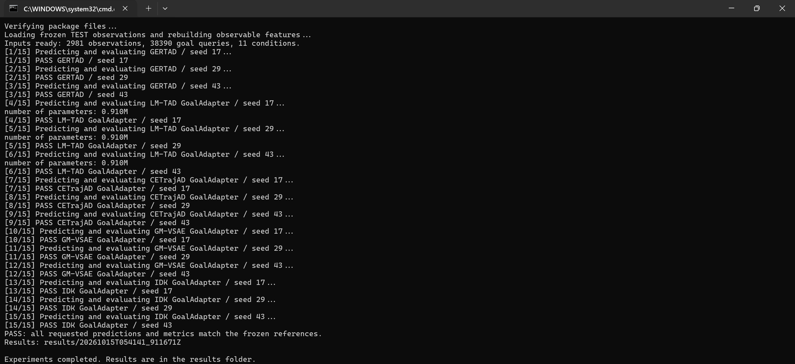

# GERTAD

**Goal-Relative Evidence Recovery for Trajectory Anomaly Detection**

Research code by Yingjun Ji. GERTAD recovers shared physical evidence from
trajectory observations and evaluates externally supplied goal contracts.
This repository contains the frozen model states, evaluation program,
controlled benchmark metadata, provider-derived POI candidates and recorded
results for GERTAD and four GoalAdapter comparison endpoints.

## Download the data and run

Install **Python 3.12** with pip. Evaluation uses the CPU; a GPU and an editor
are not required. On Windows, include the Python launcher during installation.

1. Open the [official Microsoft GeoLife download page](https://www.microsoft.com/en-us/download/details.aspx?id=52367)
   and download **`Geolife Trajectories 1.3.zip`** (about 299 MB). Read the
   dataset terms included in that archive. GeoLife GPS coordinates are
   downloaded separately and are not included in this repository.
2. Create `data/geolife/` inside this project and place the downloaded ZIP
   there **without extracting or renaming it**. The expected layout is:

   ```text
   GERTAD/
   |-- run_experiments.cmd
   |-- run_experiments.py
   |-- README.md
   `-- data/
       `-- geolife/
           `-- Geolife Trajectories 1.3.zip
   ```

   If you already extracted the dataset, the alternative accepted layout is
   `data/geolife/Geolife Trajectories 1.3/Data/002/Trajectory/` and the other
   original user folders. Keep the original `.plt` files unchanged.
3. **Double-click `run_experiments.cmd` on Windows.** Alternatively, open a
   terminal in the project folder and run this single command:

   ```console
   python run_experiments.py
   ```

The entry prepares the trajectory input from the original files, retrieves
two pinned upstream encoder source files and installs the exact evaluation
dependencies into `.venv` when needed. The first run needs internet access
for those sources and dependencies. Later runs reuse the verified local
inputs and environment. Manual dependency installation is also available:

```console
python -m pip install -r requirements.txt
```

Input preparation reads the 190 required original trajectory files from the
ZIP, uses the frozen row indices in `config/geolife_windows.json`, and combines
them with the supplied POI candidates. It rebuilds 271 TEST contexts and
verifies that `data/worlds.json.gz` has exactly the frozen SHA-256 recorded in
[DATA.md](DATA.md). It stops before evaluation if an input differs. No map
API key or new API requests are needed. The ZIP, prepared coordinates,
downloaded source files, environment and new results are ignored by Git.
The [official-ZIP verification record](docs/input-preparation.json) documents
an independent run from that download through all 15 successful evaluations.

## Evaluation scope

The default command runs **five methods with seeds 17, 29 and 43**:
GERTAD, LM-TAD GoalAdapter, CETrajAD GoalAdapter, GM-VSAE GoalAdapter and
IDK GoalAdapter. Each of the 15 jobs performs fresh inference and evaluates
2,981 TEST observations and 38,390 goal queries across 11 conditions.
The external endpoints are the study's goal-interface adaptations.
Trained weights, validation thresholds and probability calibrations stay
fixed. This command does not retrain models or repeat historical latency
measurements and TRAIN-only component studies.

## Recorded Windows CMD run

The author supplied this screenshot of run `20261015T054141_911671Z`.
All 15 jobs passed the frozen-reference checks. Only the localized system
pause prompt and blank space below it were cropped; the retained screenshot
pixels and every experiment-output line are unchanged.



The [recorded result tables and explanation](docs/results/README.md) and
[per-job verification record](docs/results/VERIFICATION.json) preserve that
run's numerical results. All canonical prediction arrays matched exactly,
and primary/common aggregate metric differences were zero.
These are recorded results from a complete local input bundle. A fresh clone
reconstructs the same trajectory input after the official GeoLife download
has been placed at the path above.

## Find and read new results

Each execution creates `results/<UTC timestamp>/` beside `reproduce.py`.
Start with `comparison_mean_sd.csv` for three-seed means and sample standard
deviations. `comparison_by_seed.csv` contains 15 individual runs;
`classification_by_condition.csv` contains condition-specific metrics.
`SUMMARY.json` records completion. Each method/seed directory stores fresh
`predictions.npz`, primary/common metrics, a trace audit and `COMPLETED.json`.
The internal directory prefix `tad` denotes GERTAD.

Fresh predictions are saved before numerical references are loaded.
PASS means that prediction/reference and metric checks succeeded; inspect
the metric values to assess classification and recovery performance.

## Repository contents

| Path | Contents |
|---|---|
| `gertad/` | Recovery model, goals, adapted baselines, scoring and evaluation |
| `config/` | Frozen ontology, preprocessing, model registry and source identities |
| `config/geolife_windows.json` | Frozen raw-file hashes and point-row indices for local reconstruction |
| `data/` | Goal contracts, controlled metadata and separate POI candidates; see DATA.md |
| `checkpoints/` | Frozen weights and native representation states for all 15 endpoints |
| `reference/` | Prediction and metric references opened after fresh inference |
| `third_party/` | Pinned supporting code and retained upstream notices |
| `docs/` | Actual terminal screenshot and recorded result tables |
| `MANIFEST.json` | Distributed-file hashes and required external-input hashes |
| `run_experiments.py` | Single entry for input preparation and all 15 TEST jobs |

GeoLife is linked rather than redistributed. POI candidates were obtained
through the AMap POI Search API. Source notices and applicable provider terms
remain in force; see [DATA.md](DATA.md), [THIRD_PARTY.md](THIRD_PARTY.md),
[PROTOCOL.md](PROTOCOL.md), [VALIDATION.md](VALIDATION.md), and
[LICENSE_STATUS.md](LICENSE_STATUS.md). No repository-wide license has been
selected. Manuscript sources, local environments and generated run folders
are outside this repository.
